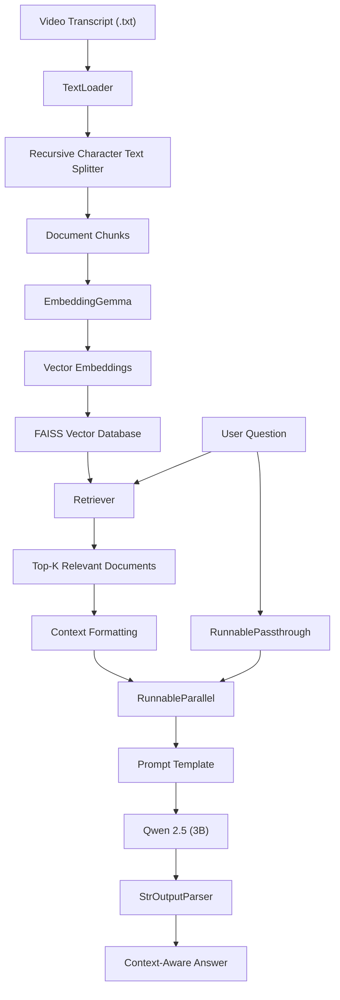

# 🎥 AI Video Explainer – RAG

**An AI-powered video understanding system that transforms video transcripts into an interactive question-answering experience using Retrieval-Augmented Generation (RAG).**

Ask questions about a video's content, retrieve relevant information from its transcript, and get context-aware answers generated by a locally running Large Language Model.

---

## 🚀 Overview

Understanding lengthy educational videos, technical lectures, and tutorials can be time-consuming. Finding a specific explanation within a long video often requires manually searching through the entire content.

**AI Video Explainer** addresses this problem using Retrieval-Augmented Generation (RAG).

The application processes video transcripts, splits them into manageable text chunks, generates vector embeddings, and stores them in a FAISS vector database. When a user asks a question, the system retrieves the most relevant transcript segments and passes them to an LLM to generate a meaningful, context-aware response.

The project uses **Ollama** to run language and embedding models locally, reducing dependency on external LLM APIs.

## ✨ Key Features

- **Transcript Processing:** Loads and processes video transcripts using LangChain document loaders.
- **Intelligent Text Chunking:** Uses Recursive Character Text Splitter to divide lengthy transcripts into smaller, overlapping chunks.
- **Semantic Embeddings:** Converts transcript chunks into numerical vector representations using EmbeddingGemma.
- **Vector Search:** Uses FAISS for efficient similarity-based document retrieval.
- **Context-Aware Responses:** Retrieves relevant transcript information before generating an answer.
- **Local LLM Integration:** Uses Qwen 2.5 (3B) through Ollama for local text generation.
- **Retrieval-Augmented Generation:** Combines document retrieval and LLM generation to produce answers grounded in transcript context.

## 🏗️ System Architecture



## 🧠 How It Works

The project follows two major stages:

### 1. Indexing Pipeline

This stage prepares the transcript for semantic search.

1. **Document Loading:** Loads the transcript using LangChain's `TextLoader`.
2. **Text Splitting:** Divides the transcript into chunks using `RecursiveCharacterTextSplitter`.
3. **Embedding Generation:** Uses `embeddinggemma:latest` to convert each chunk into a vector.
4. **Vector Storage:** Stores the generated embeddings and associated documents in FAISS.

### 2. Retrieval and Generation Pipeline

This stage answers user questions using the indexed transcript.

1. **User Query:** The user submits a question about the video.
2. **Similarity Search:** The retriever searches FAISS for the most relevant transcript chunks.
3. **Context Formatting:** Retrieved documents are combined into a single context string.
4. **Parallel Execution:** `RunnableParallel` prepares the retrieved context and original question simultaneously.
5. **Prompt Construction:** `PromptTemplate` combines the context and question into a structured prompt.
6. **LLM Generation:** Qwen 2.5 (3B) generates an answer using the supplied transcript context.
7. **Output Parsing:** `StrOutputParser` extracts the final response as a string.

## 🛠️ Tech Stack

| Technology | Purpose |
|---|---|
| Python | Core programming language |
| LangChain | LLM application development and RAG orchestration |
| Ollama | Local model execution |
| EmbeddingGemma | Text embedding generation |
| Qwen 2.5 (3B) | Answer generation |
| FAISS | Vector storage and similarity search |
| RecursiveCharacterTextSplitter | Transcript chunking |

## 📂 Project Structure

```text
AI-Video-Explainer-RAG/
│
├── transcript.txt
│
├── main.py
│
├── requirements.txt
│
├── README.md
│
└── .gitignore
```

*Note: Update this structure if your repository contains additional modules or folders.*

## ⚙️ Installation and Setup

### Prerequisites

- Python 3.10+
- Git
- Ollama installed on your system

### Step 1: Clone the Repository

```bash
git clone https://github.com/YashRaj363/AI-Video-Explainer-RAG.git
```

```bash
cd AI-Video-Explainer-RAG
```

### Step 2: Create a Virtual Environment

```bash
python -m venv venv
```

Activate it:

**Windows PowerShell**

```powershell
.\venv\Scripts\Activate.ps1
```

**Linux / macOS**

```bash
source venv/bin/activate
```

### Step 3: Install Dependencies

```bash
pip install -r requirements.txt
```

If you do not have a requirements file yet, install the main dependencies:

```bash
pip install langchain langchain-community langchain-core langchain-text-splitters langchain-ollama faiss-cpu
```

### Step 4: Download Ollama Models

Make sure Ollama is installed and running.

Pull the embedding model:

```bash
ollama pull embeddinggemma:latest
```

Pull the chat model:

```bash
ollama pull qwen2.5:3b
```

Verify the downloaded models:

```bash
ollama list
```

### Step 5: Add Your Transcript

Place your video transcript in the project directory and name it:

```text
transcript.txt
```

Update the filename in the loader if necessary.

### Step 6: Run the Application

```bash
python main.py
```

## 💻 Example Interaction

**User Question:**

```text
What is RLHF?
```

**System Workflow:**

```text
User Question
     ↓
FAISS Similarity Search
     ↓
Retrieve Relevant Transcript Chunks
     ↓
Format Retrieved Context
     ↓
Construct LLM Prompt
     ↓
Qwen 2.5 (3B)
     ↓
Generate Answer
```

**Expected Answer:**

The system generates an answer based on the information retrieved from the transcript. If the retrieved context does not contain sufficient information, the prompt instructs the model to respond that it does not know.

## 🔍 Core LangChain Components

| Component | Responsibility |
|---|---|
| `TextLoader` | Loads transcript files |
| `RecursiveCharacterTextSplitter` | Splits documents into chunks |
| `OllamaEmbeddings` | Generates text embeddings |
| `FAISS` | Stores and searches vector embeddings |
| `as_retriever()` | Provides a document retrieval interface |
| `ChatOllama` | Generates responses using the local LLM |
| `PromptTemplate` | Structures the LLM prompt |
| `RunnableParallel` | Processes context and question branches |
| `RunnableLambda` | Executes custom document-formatting logic |
| `RunnablePassthrough` | Passes the original question unchanged |
| `StrOutputParser` | Extracts the generated text response |

## ⚡ Future Improvements

- [ ] Integrate YouTube URL support for automatic transcript extraction.
- [ ] Support multiple video transcripts.
- [ ] Build an interactive frontend using Streamlit.
- [ ] Add conversation memory for follow-up questions.
- [ ] Implement video timestamp-based retrieval.
- [ ] Improve full-video summarization using Map-Reduce or other summarization strategies.
- [ ] Add support for additional embedding and chat models.
- [ ] Persist and reload FAISS indexes to avoid rebuilding the vector database every time.

## 🎯 Learning Outcomes

Through this project, the following concepts are explored:

- Retrieval-Augmented Generation (RAG).
- Text embeddings and semantic similarity.
- Vector databases and FAISS.
- LangChain document loaders and text splitters.
- LangChain Runnable architecture.
- Prompt engineering and context-aware generation.
- Running LLMs and embedding models locally using Ollama.

## 🤝 Contributing

Contributions, suggestions, and improvements are welcome!

1. Fork the repository.
2. Create a new feature branch.
3. Commit your changes.
4. Push the branch.
5. Open a Pull Request.

## 👨‍💻 Author

**Yash Raj**

B.Tech – Computer Science and Engineering

GitHub: [@YashRaj363](https://github.com/YashRaj363)

---

⭐ If you find this project useful, consider giving the repository a star!

**Built with Python, LangChain, FAISS and Ollama.**
